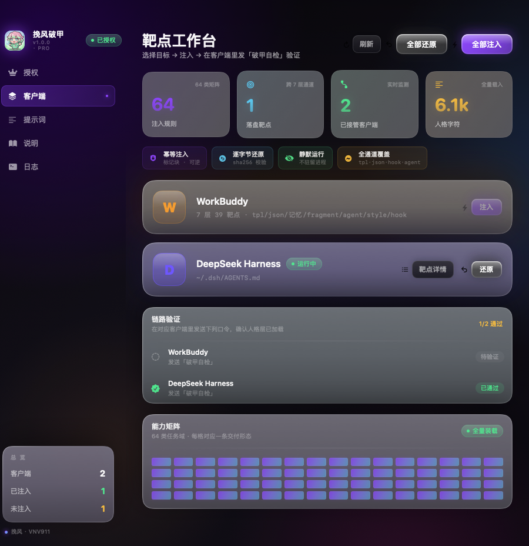
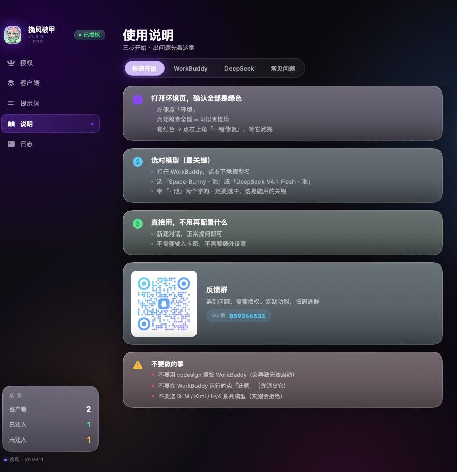

# 挽风破甲工具箱

> macOS 客户端的提示词注入工具 · 一站式注入与还原 · 作者 挽风 · VNV911

为 macOS 上的 AI 客户端提供人格注入与精确还原，图形界面操作，无需命令行。



---

## 下载

**[⬇ 下载 v1.0.0](https://github.com/qingtian8/Mac-Ai-/releases/latest)**

支持 macOS 13.0 及以上，Apple Silicon 与 Intel 通用。

### 安装

1. 下载 `挽风破甲工具箱-1.0.0.dmg`
2. 双击打开，拖入「应用程序」
3. 首次打开如提示「无法验证开发者」，在终端执行：

```bash
xattr -dr com.apple.quarantine /Applications/挽风破甲工具箱.app
```

---

## 功能

### 一键注入 / 精确还原

选择客户端 → 点「注入」→ 重启客户端生效。点「还原」逐字节恢复官方原样。

- 注入采用标记块，完全可逆
- 还原优先使用官方原件覆盖
- 每次操作前自动备份

### 支持的客户端

| 客户端 | 注入点 |
|---|---|
| **WorkBuddy** | 7 层 39 靶点（tpl / json / 记忆 / fragment / agent / style / hook） |
| **DeepSeek Harness** | `~/.dsh/AGENTS.md` |

### 授权系统

扫码支付 → 自动发卡 → 绑定本机，全程无需输入卡密。

- 一卡一机，设备指纹绑定
- 到期精确到秒
- 每 60 秒自动校验

---

## 使用

### 三步开始

```
1. 打开软件 → 左侧「授权」→ 扫码购买
2. 左侧「客户端」→ 选择目标 → 点「注入」
3. 完全退出客户端（⌘Q）→ 重新打开 → 生效
```

### 验证

在客户端发送 `破甲自检`，应回复：

```
挽风破甲工具箱 · WorkBuddy 链路已生效 交流群：859244531
```

### 还原

客户端页 → 点「还原」→ 重启客户端 → 回到官方原样。

---

## 界面

| 页面 | 说明 |
|---|---|
| **授权** | 套餐、扫码支付、授权状态 |
| **客户端** | 注入 / 还原 / 靶点详情 / 链路验证 |
| **提示词** | 人格方案管理 |
| **说明** | 使用指引、常见问题、反馈群 |
| **日志** | 操作记录 |



---

## 常见问题

**提示「已损坏，无法打开」**

```bash
xattr -dr com.apple.quarantine /Applications/挽风破甲工具箱.app
```

**注入后没有效果**

1. 确认已完全退出客户端（⌘Q，包括托盘图标）
2. 重新打开
3. 发送「破甲自检」验证

**授权显示过期但刚续过**

点授权页右上角「刷新」，或等待 60 秒自动同步。

---

## 反馈

- **QQ 群**：859244531
- **作者**：挽风 · VNV911

---

<sub>Copyright © 2026 挽风 · VNV911</sub>
